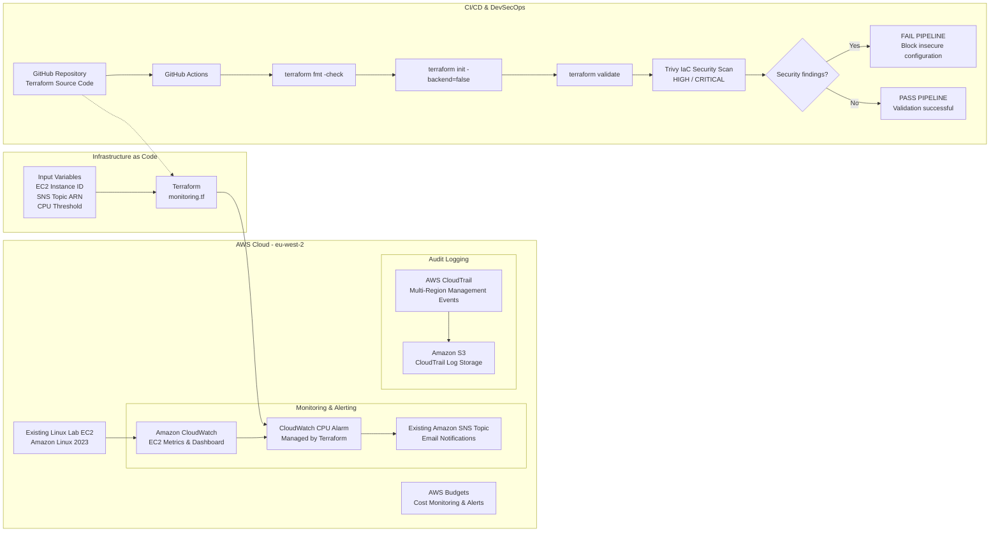
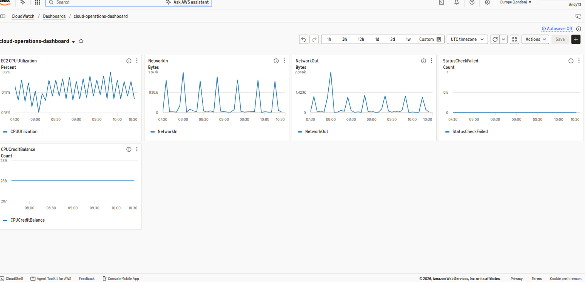
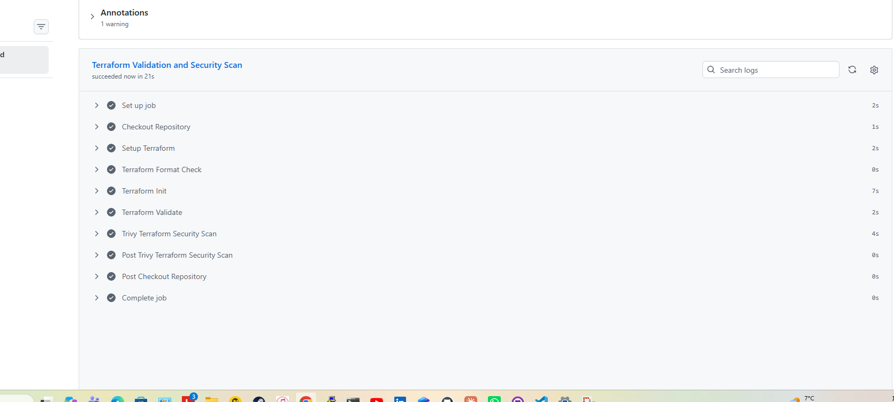
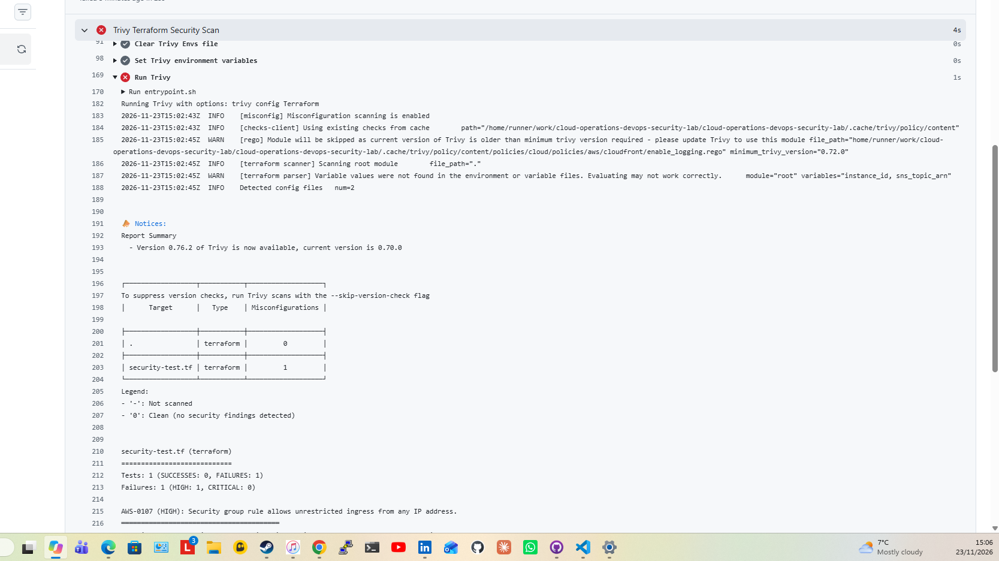
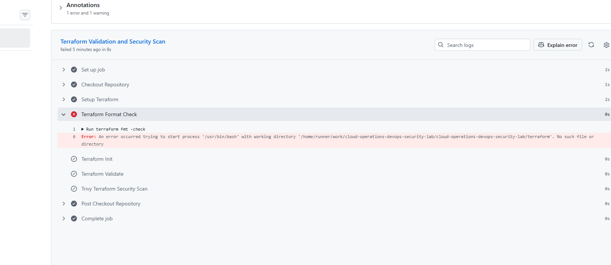

# Cloud Operations, DevOps & Security Lab

## Overview

This project extends my existing Linux Infrastructure Lab by adding cloud operations, security monitoring, audit logging, automated alerting, cost monitoring, Infrastructure as Code, CI/CD and DevSecOps practices using AWS, Terraform, GitHub Actions and Trivy.

The goal is to develop practical hands-on experience operating, monitoring, securing and automating cloud infrastructure while applying Infrastructure as Code and security best practices.

This project also documents troubleshooting and remediation rather than only the successful end state.

---

## Architecture

The lab extends an existing Amazon Linux 2023 EC2 environment with monitoring, alerting, audit logging and cost controls.

Terraform currently manages the CloudWatch CPU alarm and integrates it with the existing EC2 instance and SNS notification topic through input variables.

CloudTrail, S3 audit-log storage, the CloudWatch dashboard and AWS Budgets form part of the wider lab environment but are not currently provisioned by this repository's Terraform configuration.



---

## Technologies

- AWS EC2
- Amazon Linux 2023
- AWS IAM
- AWS CloudTrail
- Amazon CloudWatch
- Amazon SNS
- Amazon S3
- AWS Budgets
- Terraform
- GitHub Actions
- Trivy
- Git
- GitHub

---

## Project Objectives

- Establish and document a cloud security baseline
- Review identity and access management controls
- Implement account-wide audit logging
- Monitor infrastructure health and performance
- Configure automated operational alerts
- Introduce cost monitoring
- Manage monitoring configuration using Terraform
- Build an automated Terraform CI pipeline
- Integrate Infrastructure as Code security scanning
- Demonstrate a practical DevSecOps detection and remediation workflow
- Document troubleshooting and lessons learned

---

## Current Status

- [x] Security Baseline Assessment
- [x] CloudTrail Implementation
- [x] CloudWatch Monitoring
- [x] CloudWatch CPU Alarm
- [x] SNS Email Alerting
- [x] AWS Budget Monitoring
- [x] Terraform Monitoring Configuration
- [x] GitHub Actions CI Pipeline
- [x] Terraform Format Validation
- [x] Terraform Configuration Validation
- [x] Trivy Infrastructure as Code Security Scanning
- [x] DevSecOps Security Gate Testing
- [x] Security Misconfiguration Remediation
- [x] Architecture Diagram
- [x] Portfolio Evidence
- [ ] Additional Monitoring Resources as Infrastructure as Code
- [ ] Additional CloudWatch Security Monitoring

---

## Security Baseline Assessment

A security baseline assessment was performed against the existing Linux Infrastructure Lab before implementing additional monitoring and security controls.

Areas reviewed included:

- AWS IAM configuration
- Root account MFA
- IAM user MFA
- Access key usage
- IAM permissions
- EC2 Security Groups
- SSH configuration
- SSH key authentication
- Root login configuration
- Linux patch status

### Key Findings

- MFA enabled for the AWS root account
- MFA enabled for the administrative IAM user
- Small IAM identity footprint
- SSH access restricted to a trusted IP address
- Password-based SSH authentication disabled
- SSH key authentication enabled
- No unnecessary management or database ports publicly exposed
- Linux update status reviewed
- Administrative permissions identified as an area for future least-privilege review

The assessment established the security posture of the environment before introducing additional auditing, monitoring and DevSecOps controls.

A more detailed assessment is available in [`security-baseline.md`](security-baseline.md).

---

## AWS CloudTrail Audit Logging

AWS CloudTrail was implemented to provide visibility into account activity and infrastructure changes.

### Configuration

- Multi-region trail
- Management event logging
- Read and write event capture
- Amazon S3 log storage
- Audit event history verification

CloudTrail successfully recorded infrastructure lifecycle and configuration activity including:

- EC2 instance operations
- Security Group changes
- Elastic IP operations
- CloudTrail configuration activity
- S3 configuration activity

This provides an audit trail that can support operational investigation, change tracking and security analysis.

---

## CloudWatch Monitoring Dashboard

An Amazon CloudWatch dashboard was created to provide operational visibility into the Linux Infrastructure Lab.

### Metrics Monitored

- EC2 CPU Utilization
- Network In
- Network Out
- EC2 Status Checks
- CPU Credit Balance

The dashboard provides a central view of infrastructure performance, health and network activity.



---

## CloudWatch Alarms & SNS Alerting

Proactive monitoring was implemented using Amazon CloudWatch Alarms and Amazon SNS.

### CPU Alarm

**Alarm:** `linux-lab-high-cpu`

Configuration:

- Metric: `CPUUtilization`
- Threshold: Greater than 70%
- Period: 5 minutes
- Evaluation periods: 1
- Notification target supplied through the SNS topic ARN input variable

The CloudWatch alarm sends notifications through the existing Amazon SNS topic.

This changes the monitoring approach from passive dashboard observation to automated alerting.

---

## AWS Budget Monitoring

AWS Budget monitoring was configured to improve visibility of cloud expenditure.

A monthly cost budget and threshold notification provide early warning when spending reaches the configured level.

This introduces cost awareness alongside operational and security monitoring and helps reduce the risk of unexpected cloud expenditure.

---

## Terraform Infrastructure as Code

Terraform was introduced to manage part of the monitoring configuration through Infrastructure as Code.

The current Terraform configuration manages the CloudWatch CPU alarm while referencing existing infrastructure through input variables.

### Terraform Structure

```text
Terraform/
├── .terraform.lock.hcl
├── monitoring.tf
└── variables.tf
```

### Input Variables

The configuration uses variables for:

- AWS region
- EC2 instance ID
- SNS topic ARN
- CPU alarm threshold
- Environment tag

This keeps environment-specific values separate from the reusable monitoring configuration.

### Version Controls

The Terraform configuration defines:

- Terraform CLI: `>= 1.16.0, < 2.0.0`
- AWS provider: `~> 6.73`

The dependency lock file is retained in version control to provide consistent provider selection.

---

## CI/CD with GitHub Actions

A GitHub Actions workflow validates the Terraform configuration whenever changes are pushed to `main` or submitted through a pull request to `main`.

The pipeline performs:

1. Repository checkout
2. Terraform setup
3. `terraform fmt -check`
4. `terraform init -backend=false`
5. `terraform validate`
6. Trivy Infrastructure as Code security scanning

The Trivy step scans for HIGH and CRITICAL security findings and returns a non-zero exit code when qualifying findings are detected.

### Successful Validation Pipeline

The completed pipeline demonstrates automated formatting checks, Terraform initialisation, configuration validation and security scanning.



---

## DevSecOps Security Gate Test

The security gate was deliberately tested by introducing an insecure Terraform configuration.

The test configuration allowed unrestricted ingress from any IP address.

When the change passed through the GitHub Actions workflow, Trivy detected the configuration and reported:

**AWS-0107 (HIGH): Security group rule allows unrestricted ingress from any IP address.**

The security scan returned a failure and prevented the configuration from passing the complete validation pipeline.



The deliberately insecure configuration was then removed/remediated and the workflow was run again.

The corrected configuration successfully passed:

- Terraform formatting
- Terraform initialisation
- Terraform validation
- Trivy security scanning

This demonstrated the complete workflow:

```text
Introduce insecure configuration
        ↓
Commit / push
        ↓
GitHub Actions
        ↓
Terraform validation
        ↓
Trivy security scan
        ↓
HIGH severity finding
        ↓
Pipeline fails
        ↓
Investigate and remediate
        ↓
Run pipeline again
        ↓
Security scan passes
```

---

## Troubleshooting & Lessons Learned

The project deliberately retains evidence of troubleshooting because successful infrastructure engineering involves diagnosing failures as well as deploying working systems.

### GitHub Actions Working Directory Failure

During initial implementation of the CI workflow, the Terraform format step failed because the configured working directory did not match the actual repository directory structure.

The failure occurred before Terraform Init, Validate and Trivy could run.



The repository structure and workflow configuration were reviewed, the path was corrected and the pipeline was executed again successfully.

### Security Gate Validation

Rather than assuming the Trivy integration worked simply because the workflow completed, an intentionally insecure Terraform configuration was introduced to test the control.

The scan correctly identified the HIGH-severity unrestricted-ingress configuration and failed the pipeline.

Following remediation, the pipeline successfully completed.

### Key Lessons

- CI/CD pipelines need to be tested in both success and failure scenarios.
- Infrastructure security controls are more valuable when their failure behaviour is validated.
- Infrastructure as Code makes configuration changes repeatable and reviewable.
- Monitoring and alerting provide complementary forms of operational visibility.
- Clear repository structure and documentation make troubleshooting easier.
- Security, operational reliability and cost awareness should be treated together rather than as isolated concerns.

---

## Evidence

The `evidence/` directory contains selected screenshots from the implementation and troubleshooting process:

```text
evidence/
├── cloudwatch-dashboard.png
├── github-actions-path-error.png
├── github-actions-security-pass.png
└── trivy-high-severity-detection.png
```

These screenshots provide evidence of monitoring, CI/CD validation, troubleshooting and automated security control testing.

---

## Repository Structure

```text
cloud-operations-devops-security-lab/
├── .github/
│   └── workflows/
│       └── terraform-validation.yml
├── Terraform/
│   ├── .terraform.lock.hcl
│   ├── monitoring.tf
│   └── variables.tf
├── evidence/
│   ├── cloudwatch-dashboard.png
│   ├── github-actions-path-error.png
│   ├── github-actions-security-pass.png
│   └── trivy-high-severity-detection.png
├── .gitattributes
├── .gitignore
├── README.md
└── security-baseline.md
```

---

## What This Project Demonstrates

This project demonstrates practical hands-on experience with:

- AWS infrastructure operations
- Linux infrastructure monitoring
- AWS security auditing
- CloudWatch dashboards and alarms
- SNS alerting
- Cloud cost awareness
- Terraform Infrastructure as Code
- Git and GitHub
- GitHub Actions CI/CD
- Automated Terraform validation
- Infrastructure as Code security scanning
- DevSecOps security gates
- Security misconfiguration detection and remediation
- Technical troubleshooting
- Documentation of engineering decisions and lessons learned

The project reflects an operational approach to cloud engineering: build infrastructure, monitor it, secure it, automate validation, deliberately test controls, troubleshoot failures and document the outcome.